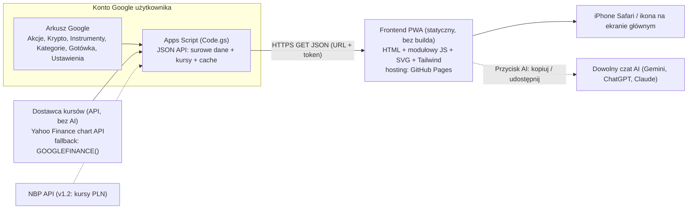

# PRD — myMarket: osobisty dashboard portfela inwestycyjnego

| | |
|---|---|
| **Wersja** | 0.2 (zatwierdzony zakres v1.0) |
| **Data** | 22.11.2026 |
| **Status** | v1.0 zaimplementowana |
| **Bazuje na** | Prototyp „Struktura portfela akcyjnego — 20.11.2026” (HTML + SVG + Tailwind) |

---

## 1. Cel produktu

Lekkie, czytelne narzędzie webowe (otwierane głównie na iPhonie z ekranu głównego, a także na desktopie), które:

1. Czyta transakcje i gotówkę z **Arkusza Google** użytkownika (jedyne źródło prawdy, edytowalne z każdego miejsca).
2. Samo wylicza pozycje (liczba akcji, średnia cena zakupu, koszt, wynik niezrealizowany, wynik dzienny).
3. Pobiera **aktualne kursy** czysto przez API — **bez żadnego udziału AI i bez płatnych subskrypcji** (w tym pre-market / after-hours) — i pokazuje strukturę portfela na **interaktywnym wykresie pierścieniowym** w stylu prototypu.
4. Jest **wielodostępne**: jeden wspólny frontend, a każdy użytkownik podłącza własną kopię arkusza ze swoim tokenem.
5. Umożliwia **eksport stanu portfela dla AI** jednym kliknięciem (Markdown / JSON), aby łatwo konsultować kolejne decyzje inwestycyjne.
6. Ma architekturę przygotowaną na kolejne fazy: PLN (kursy NBP), rynki spoza USA (GPW/EUR), metodę FIFO i historię wartości.

### Zasady projektowe
- **Biało, przejrzyście, czytelnie** — wygląd prototypu jest punktem odniesienia; bez zbędnych górnych kart KPI (wszystko widać w środku wykresu i na liście).
- **Mobile-first** (iPhone Safari + PWA), pełny układ dwukolumnowy na desktopie.
- **Arkusz = baza danych.** Aplikacja w v1 jest tylko do odczytu; wszystkie zmiany robi się w arkuszu.
- **Zero zależności od AI w działaniu aplikacji** — każdy może korzystać za darmo.
- **Szybkie MVP, czysty podział warstw** — wymienne warstwy (źródło danych, dostawca kursów, moduł obliczeń).

---

## 2. Użytkownicy

| Persona | Potrzeba |
|---|---|
| **Właściciel (Ty)** | Szybki podgląd struktury portfela i wyniku na iPhonie; dopisywanie transakcji w arkuszu; łatwe wklejanie aktualnego portfela do rozmowy z AI. |
| **Inna osoba** | Robi kopię szablonu arkusza, wdraża skrypt na swoim koncie Google, skanuje QR — ma własny dashboard bez żadnych płatnych subskrypcji. |

---

## 3. Architektura

### 3.1 Kluczowe decyzje
| Decyzja | Uzasadnienie |
|---|---|
| **Arkusz Google + Apps Script jako backend** | Zero serwerów i kosztów; skrypt kopiuje się razem z arkuszem, więc każdy użytkownik ma prywatny backend z dostępem wyłącznie do własnego pliku. Pobieranie kursów po stronie skryptu omija CORS. |
| **Hosting frontendu: GitHub Pages** | Darmowy, automatyczne wdrożenie przez GitHub Actions z katalogu `web/`. Repozytorium może być publiczne, bo nie zawiera żadnych prywatnych danych ani tokenów. |
| **Frontend bez bundlera (modułowy JS + Tailwind CDN) w v1** | Zero wymagań instalacyjnych (działa lokalnie i na GitHub Pages od razu), a logiczny podział na moduły (`api.js`, `engine.js`, `chart.js`, `ai-export.js`, `format.js`, `app.js`) pozwala bezboleśnie przejść na Vite/TypeScript, gdy aplikacja urośnie. |
| **Backend zwraca surowe dane, frontend liczy** | Przełączniki (spółki/kategorie, gotówka, krypto, pre/post, sortowanie) działają natychmiast bez ponownego żądania; wspólny silnik `engine.js` ułatwi dołożenie PLN i FIFO. |
| **Własny wykres SVG (port z prototypu)** | Zachowuje dokładny wygląd i animacje prototypu bez ciężkich bibliotek wykresowych. |

### 3.2 Bezpieczeństwo
- Web App wdrożony jako „Wykonaj jako: Ja”, „Kto ma dostęp: Każdy” + **losowy 40-znakowy token** przechowywany w `PropertiesService` skryptu.
- Link QR przekazuje dane w fragmencie `#connect?api=…&token=…` (fragment nie trafia na serwer hostujący), a aplikacja natychmiast zapisuje go w `localStorage` i czyści pasek adresu (`history.replaceState`).
- Zakres uprawnień OAuth ograniczony do `spreadsheets.currentonly` (tylko ten jeden arkusz).
- Możliwość natychmiastowego unieważnienia wszystkich linków przez `myMarket → Wygeneruj nowy token`.

### 3.3 Kursy rynkowe (100% API, bez AI)
- **Dostawca podstawowy:** Yahoo Finance chart endpoint (`query1.finance.yahoo.com/v8/finance/chart/…`) — darmowy, bez klucza, obsługuje akcje USA, ETF, krypto (`BTC-USD`), waluty (`USDPLN=X`), giełdy spoza USA (`CDR.WA`, `SAP.DE`) oraz **pre-market i after-hours**.
- **Fallback:** automatyczna ukryta zakładka `_Kursy` z formułami `GOOGLEFINANCE()` (sesja regularna, opóźnienie do ~20 min).
- **Cache** w `CacheService`: 60 s w godzinach notowań, 15 min gdy rynek zamknięty.
- **Domyślne zachowanie pre/post:** wyłączone w obliczeniach na wykresie; kurs pre/post widoczny jako dodatkowa informacja w szczegółach, a przełącznik **Pre/Post** przełącza wycenę na rozszerzoną sesję.

---

## 4. Struktura arkusza

Jeden broker (bez kolumny konta w v1). **Akcje i krypto są rozdzielone na dwie zakładki** o identycznych kolumnach — maksymalna czytelność w arkuszu i wspólny model danych w kodzie.

| Zakładka | Rola |
|---|---|
| `Start` | Krótka instrukcja obsługi i wdrożenia |
| `Akcje` | Transakcje akcji i ETF (`Data transakcji`, `Data rozliczenia`, `Typ`, `Ticker`, `Ilość`, `Cena`, `Waluta`, `Prowizja`, `Kurs PLN (auto)`, `Notatka`) |
| `Krypto` | Transakcje kryptowalut (np. `BTC`) — te same kolumny co `Akcje`, wsparcie ilości ułamkowych |
| `Instrumenty` | Słownik: `Ticker`, `Nazwa`, `Kategoria` (steruje widokiem „Wg kategorii”), `Klasa aktywa` (`Akcja`/`ETF`/`Krypto`), `Symbol notowań`, `Waluta`, `Kolor`, `Aktywny` |
| `Kategorie` | Opcjonalnie przypisanie kolorów do kategorii |
| `Gotówka` | Ręcznie wpisywane saldo (`Waluta`, `Saldo`, `Opis`) |
| `Ustawienia` | Nazwa portfela, waluta bazowa, adres frontendu, adres API |
| `_Kursy` | Ukryta, tworzona automatycznie tylko w razie fallbacku na `GOOGLEFINANCE` |

Kolumny przygotowane pod przyszłe wersje: `Data rozliczenia` i `Kurs PLN (auto)` (v1.2 — NBP), `Waluta` (v1.3 — rynki spoza USA).

---

## 5. Logika obliczeń (`web/js/engine.js`)

- Transakcje z `Akcje` i `Krypto` sortowane chronologicznie po dacie transakcji.
- **Metoda kosztu (v1):** średnia ważona; prowizja kupna zwiększa koszt pozycji, prowizja sprzedaży pomniejsza wynik zrealizowany. (FIFO dojdzie razem z PLN w v1.2.)
- **Wartość** = ilość × kurs bieżący (regularny lub pre/post zależnie od przełącznika).
- **Wynik niezrealizowany** = wartość − koszt pozostałej pozycji (kwotowo i %).
- **Zmiana dzienna** = ilość × (kurs bieżący − poprzednie zamknięcie).
- Pozycje zamknięte (ilość = 0) nie wchodzą na wykres; wynik zrealizowany jest zachowywany w silniku (widoczny w eksporcie AI, pełny widok w v1.1).

---

## 6. Zakres funkcjonalny — v1.0 (zaimplementowany)

### Ekran główny
- **Nagłówek:** nazwa portfela, status sesji + godzina kursów, przyciski **AI**, **Odśwież**, **Ustawienia**. Bez górnych kart KPI.
- **Przełączniki:**
  - `Wg spółek` / `Wg kategorii` (kategorie z zakładki `Instrumenty`),
  - chip `Gotówka` (widoczny gdy saldo > 0),
  - chip `Krypto` (widoczny gdy są otwarte pozycje krypto),
  - chip `Pre/Post` (widoczny gdy dostępne są notowania poza sesją; domyślnie wyłączony).
- **Wykres pierścieniowy SVG** (opcja pełnego koła w Ustawieniach): segmenty, etykiety ticker + %, animacja pop-out, w środku wartość, wynik łączny i zmiana dzienna (lub dane wybranego segmentu).
- **Lista pozycji pod wykresem** (na desktopie po prawej): sortowanie (`wartość`, `wynik %`, `zmiana dzienna`, `A–Z`), kliknięcie/tapnięcie zaznacza segment i rozwija szczegóły (śr. cena zakupu, kurs, koszt, wynik, kategoria, ewentualny kurs pre/post).
- **Uwagi z arkusza:** zwijana lista ostrzeżeń walidacji (brak tickera w `Instrumenty`, brak kursu, sprzedaż > stan itp.).
- **Tryb demo** gdy brak podłączonego arkusza + natychmiastowe ładowanie z lokalnego cache + auto-odświeżanie co 60 s w trakcie sesji.

### Eksport dla AI (`web/js/ai-export.js`)
- Przycisk **AI** w nagłówku otwiera gotowy podgląd portfela:
  - format **Tekst (Markdown)** lub **JSON**,
  - opcja **Ukryj kwoty** (zostają udziały %, średnie ceny, kursy i wyniki % — prywatność),
  - opcja **Dodaj prośbę** (krótki prompt startowy pod konsultację inwestycyjną),
  - przyciski **Kopiuj** oraz **Udostępnij…** (natywny arkusz udostępniania na iPhonie).
- Udziały w eksporcie zawsze liczone od całego portfela (akcje + krypto + gotówka), niezależnie od aktywnych filtrów na wykresie.

---

## 7. Roadmapa

| Wersja | Zakres |
|---|---|
| **v1.0 (gotowe)** | Arkusz (`Akcje` + `Krypto`), Apps Script API + Yahoo/GOOGLEFINANCE, wykres pierścieniowy, lista pozycji, przełączniki (spółki/kategorie/gotówka/krypto/pre-post), eksport dla AI, PWA na iPhone, GitHub Pages. |
| **v1.1** | Widok pozycji zamkniętych i wyniku zrealizowanego, szczegóły historii transakcji dla wybranej spółki, drobne poprawki po pierwszych dniach używania. |
| **v1.2 — PLN i podatki** | Automatyczne pobieranie kursu średniego **NBP (tabela A)** z ostatniego dnia roboczego przed datą rozliczenia do kolumny `Kurs PLN (auto)`; przełącznik waluty **USD / PLN** w nagłówku (z bieżącym kursem `USDPLN=X`); wynik w PLN z różnicami kursowymi; opcja metody kosztu **FIFO** (pod PIT-38). |
| **v1.3 — Rynki spoza USA i wielowalutowość** | Obsługa spółek w PLN (GPW, np. `CDR.WA`), EUR (np. `SAP.DE`), GBP itp. — przeliczanie kursów walutowych w locie, gotówka w wielu walutach, wspólna wycena w wybranej walucie bazowej. |
| **v2.x — Rozwój** | Wykres wartości portfela w czasie (dzienne snapshoty triggerem Apps Script do zakładki `Historia`), dywidendy, porównanie z benchmarkiem (S&P 500 / Nasdaq), docelowe wagi i kalkulator rebalancingu, tryb ciemny, wiele kont/brokerów, opcjonalne logowanie Google OAuth. |

---

## 8. Historia zmian PRD

| Wersja | Data | Zmiana |
|---|---|---|
| 0.1 | 22.11.2026 | Pierwszy draft na bazie prototypu i wymagań użytkownika. |
| 0.2 | 22.11.2026 | Uwzględniono decyzje użytkownika: GitHub Pages, osobne zakładki `Akcje`/`Krypto`, domyślnie wyłączone pre/post, jeden broker, rynki spoza USA na roadmapie, brak zależności od AI w pobieraniu kursów, eksport portfela dla AI, architektura zero-build dla v1.0. |
